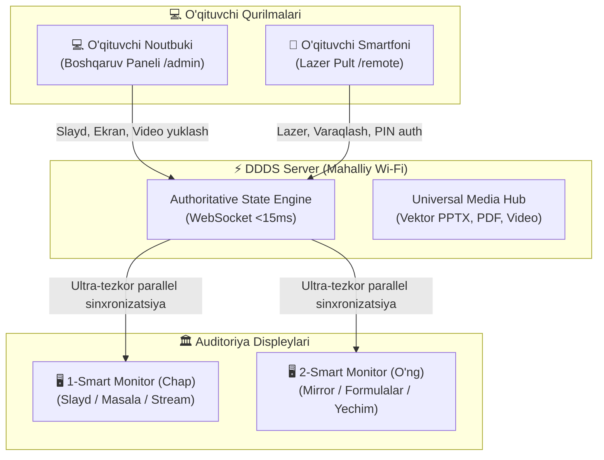

# 🏛 DDDS Cloud — Smart Auditoriya Dual-Display Platformasi
## Foydalanish Bo'yicha Mukammal Yo'riqnoma

**DDDS Cloud** (*Distributed Dual-Display Smart Classroom Platform*) — universitet va ta'lim muassasalaridagi auditoriyalarda ikkita mustaqil Smart Monitorni (Dual-Display) simsiz, real vaqtda sinxron boshqarish uchun mo'ljallangan 100% veb-asosli innovatsion platforma.

---

### 📑 Mundarija
1. [Tizim Arxitekturasi va Qanday Ishlashi](#1-tizim-arxitekturasi-va-qanday-ishlashi)
2. [Tezkor Ishga Tushirish (Quick Start — 3 Daqiqada)](#2-tezkor-ishga-tushirish-quick-start)
3. [Zaldagi 2 ta Smart Monitorni Sozlash](#3-zaldagi-2-ta-smart-monitorni-sozlash)
4. [O'qituvchi Boshqaruv Paneli (Noutbuk / Planshet)](#4-oqituvchi-boshqaruv-paneli)
5. [Smartfon Masofaviy Pulti va Lazer Ko'rsatkich](#5-smartfon-masofaviy-pulti-va-lazer-korsatkich)
6. [Smart Monitorda Interaktiv Doska va Touch Boshqaruv](#6-smart-monitorda-interaktiv-doska)
7. [Auditoriyalar Boshqaruvi va Stol A4 QR Stendi](#7-auditoriyalar-boshqaruvi-va-stol-stendi)
8. [Muammolarni Hal Qilish (Troubleshooting & FAQ)](#8-muammolarni-hal-qilish-faq)

---

### 1. Tizim Arxitekturasi va Qanday Ishlashi

DDDS tizimi kompyuterga hech qanday drayver, dastur yoki `.exe` o'rnatmasdan (Zero-Driver, Zero-Install), to'liq mahalliy Wi-Fi tarmog'i va WebSocket texnologiyasi orqali ishlaydi.



---

### 2. Tezkor Ishga Tushirish (Quick Start)

1. **Serverni yoqish:**
   - Noutbukda `start.bat` faylini ikki marta bosing (yoki terminalda `python run.py`).
   - Qora darchada noutbukingizning Wi-Fi IP manzili chiqadi (masalan: `http://10.29.52.241:8000`).

2. **Smart Monitorlarni ulash:**
   - Chap Smart TV brauzerida: `http://<IP>:8000/screen/204/1`
   - O'ng Smart TV brauzerida: `http://<IP>:8000/screen/204/2`
   - Klaviaturada **F11** ni bosing (to'liq ekran).

3. **O'qituvchi panelini ochish:**
   - Noutbukingiz brauzerida `http://localhost:8000` ga kiring va o'z xonangizning **"Boshqaruv Paneli"** tugmasini bosing.

4. **Smartfonni ulash:**
   - Stol ustidagi QR kodni telefon kamerangizda skanerlang yoki telefonda `http://<IP>:8000/remote/204` ga kirib, PIN-kodni (`2040`) tering.

---

### 3. Zaldagi 2 ta Smart Monitorni Sozlash

Har safar zalga kirganda manzilni qo'lda terib o'tirmaslik uchun quyidagi 3 ta qulay yo'ldan birini tanlang:

#### 1-yo'l: Bosh sahifa qilib sozlash (Eng osoni)
* Televizor pultidan brauzer sozlamalariga (**Settings ⚙️**) kiring.
* **"On startup"** (Brauzer ochilganda) qismiga kiring va doimiy ochiladigan sahifa qilib belgilang:
  * Chap monitorda: `http://<KOMPYUTER_IP>:8000/screen/204/1`
  * O'ng monitorda: `http://<KOMPYUTER_IP>:8000/screen/204/2`
* **Natija:** Smart TV pultidan brauzerni bosishingiz bilan monitor to'g'ridan-to'g'ri tizimga ulanadi.

#### 2-yo'l: Xatcho'p (Bookmark ⭐)
* Manzilni bir marta ochib, pultdan yulduzcha (**Bookmark**) tugmasini bosing. Keyingi darslarda brauzerga kirib 1 ta bosishda ochiladi.

#### 3-yo'l: Mini-PC yoki Android Box orqali Avto-yuklanish (Auto-Kiosk)
* Televizor orqasiga mini-kompyuter ulangan bo'lsa, uni avtozagruzkaga qo'yish mumkin:
  ```cmd
  chrome.exe --kiosk --start-fullscreen http://<KOMPYUTER_IP>:8000/screen/204/1
  ```
* Tok yoqilishi bilanoq monitorlar avtomatik ulanadi.

> [!TIP]
> **IP o'zgarmasligi uchun:** Noutbukingizda **"Mobile Hotspot"** (Tarqatish nuqtasi)ni yoqsangiz, noutbukingiz IP manzili doimiy `192.168.137.1` bo'ladi. Monitorlarni shu manzilga bir marta ulab qo'ysangiz, internet bo'lmaganda ham har doim bir xil ishlayveradi.

---

### 4. O'qituvchi Boshqaruv Paneli

Boshqaruv paneli manzili: `http://localhost:8000/admin/{room_id}`

#### A. Taqdimotlar yuklash (PPTX, PDF)
1. **"Taqdimotlar & Slaydlar"** yorlig'iga o'ting.
2. PowerPoint (`.pptx`) yoki PDF faylni yuklash maydoniga sudrab tashlang (Drag & Drop).
3. **Progress Bar (Yuklash indikatori):** Yuklanish foizi ko'rinadi va server faylni yuqori aniqlikdagi vektorli slaydlarga aylantiradi.
4. Slaydlar formulasi, shriftlari va dizayni 100% aslidek chiqadi.

#### B. Dual-Display Rejimlari
* **Ko'zgu (Mirror):** Ikkala monitorda bir xil slayd aks etadi (katta auditoriyalar va zallar uchun).
* **Kengaytirilgan (Split):** 
  * 1-Monitor (Chap): Yangi mavzu, asosiy slayd yoki masala sharti.
  * 2-Monitor (O'ng): Mavzuga oid formulalar, tushuntirish yoki yechim.

#### C. Jonli Ekranni Uzatish (Screen Share — 60 FPS & Zaxira Dvigateli)
* **"🔴 Jonli Ekranni Uzatish"** tugmasini bosing.
* Ochilgan oynadan butun ekranni yoki aniq bir dasturni (masalan: Visual Studio Code, AutoCAD, Excel, 3D model, Brauzer) tanlang.
* **Ikki tomonlama kafolatlangan uzatish (Dual-Engine):**
  1. *WebRTC Ultra-HD (1080p 60FPS)* — 0ms kechikish bilan harflar va chizmalarni tiniq ko'rsatadi.
  2. *Adaptive Canvas Streamer* — Agar universitet Wi-Fi tarmog'i P2P oqimlarni to'ssa, avtomatik ravishda WebSocket orqali kadrlarni uzatadi (qora ekran yuzaga kelmaydi).
* **Audio ovozni boshqarish:** 1-Smart monitorda **"🔊 Ovozni Yoqish"** tugmasi orqali videodagi ovozni zaldagi karnaylarga chiqarish mumkin (2-monitor esa aks-sado bermasligi uchun ovozsiz ishlaydi).
* **Lazer ko'rsatkich:** Smartfon pultidagi lazer ko'rsatkich jonli video ustida ham 100% aniqlikda harakatlanadi.
* **Smartfon pultidan boshqarish:** O'qituvchi doska oldida turib telefon pultidagi **"📄 Slaydlarga Qaytish"** tugmasini bosish orqali efirni to'xtatib darhol taqdimotga qaytishi mumkin.

#### D. O'qituvchi Noutbukining To'liq Erkinligi
* O'qituvchi noutbukida boshqa darchalarni ochib, talabalarni baholashi, Telegram yoki hujjatlar bilan ishlashi mumkin.
* Boshqa darchada ishlashingiz monitorlardagi taqdimotga aslo xalaqit bermaydi.

#### E. Tezkor Boshqaruv Tugmalari:
* `◀ Oldingi Slayd` / `Keyingi Slayd ▶` — Slaydlarni o'tkazish
* `💻 F5 Boshlash` — Taqdimotni boshiga qaytarish
* `🟠 Qoraytirish (B)` — Ekranni qoraytirish (diqqatni o'qituvchiga qaratish)
* `🔒 Bloklash` — Monitorlarni to'liq qulflash (o'quvchilar tegolmaydi)
* `✋ Sensorni Bloklash` — **Yangi funksiya (Palm Rejection):** Ekranga tana, qo'l yoki kiyim beixtiyor tegib ketganda slayd o'tib ketmasligi uchun sensorni bloklaydi. **Bunda fizik USB pult (chip) va smartfon pulti 100% ishlashda davom etadi!**

---

### 5. Smartfon Masofaviy Pulti va Lazer Ko'rsatkich

O'qituvchi doska oldida erkin yurishi uchun smartfonidan foydalanadi:

1. **Ulanish:** Telefondan `http://<IP>:8000/remote/{room_id}` ga kiring yoki QR kodni skanerlang.
2. **PIN-kod:** 4 xonali xavfsizlik PIN-kodini kiriting (masalan: `2040`). Tizim shifrlangan seans tokeni yaratadi.
3. **Lazer ko'rsatkich (Touchpad):**
   * Telefon ekranidagi to'q rangli maydonda barmog'ingizni yurgizing.
   * Ikkala zal monitorida yorqin qizil lazer nuqtasi barmog'ingiz harakatini 100% aniqlikda takrorlaydi.
4. **Maxfiy Ma'ruzachi Eslatmalari (Speaker Notes):**
   * Taqdimot slaydlari ostidagi ma'ruza matnlari faqat sizning telefoningizda ko'rinadi, talabalarga ko'rinmaydi.
5. **Qoraytirish va Doska:**
   * **⬛ Qoraytirish:** Monitorni bir lahzada qoraytirib, talabalar diqqatini jonli nutqqa qaratadi.
   * **📋 Doska:** Bir bosishda oq interaktiv doskaga o'tadi.

---

### 6. Smart Monitorda Interaktiv Doska va Fizik USB Pultlar

Agar zal monitorlari sensorli (Smart Board) bo'lsa:
* **Barmoq bilan varaqlash:** Monitor ekranining o'ng tomoniga tegsangiz — keyingi slaydga, chap tomoniga tegsangiz — oldingi slaydga o'tadi.
* **Ekranga chizish:** Monitor pastidagi suzuvchi panelni ochib, qalam (marker) rangini tanlab, to'g'ridan-to'g'ri slayd ustiga formulalar yoki chizmalar chizishingiz mumkin.
* **O'chirish:** Bitta tugma bilan chizilgan chiziqlarni tozalash mumkin.

#### 📡 Fizik USB Prezenter-Pult (Hardware Dongle):
* Monitordagi USB portga Logitech, Baseus yoki boshqa prezenter-pultning kichik USB chipi ulangan bo'lsa, u **avtomatik tarzda to'liq ishlaydi**:
  * Pultdagi `Oldinga` tugmasi (`PageDown` / `ArrowRight`) -> Keyingi slayd
  * Pultdagi `Orqaga` tugmasi (`PageUp` / `ArrowLeft`) -> Oldingi slayd
  * Pultdagi `Qoraytirish` tugmasi (`B` / `.`) -> Ekranni qoraytirish
* **Eng muhimi:** O'qituvchi boshqaruv panelidan **"✋ Sensorni Bloklash"** rejimini yoqsa ham, fizik pult to'xtovsiz va chaqqon ishlashda davom etadi, ammo ekranga qo'l tegib ketganda slayd qimirlamaydi!

---

### 7. Auditoriyalar Boshqaruvi va Stol Stendi

Bosh sahifada (`http://localhost:8000`):
* **Yangi xona ochish:** **"+ Yangi Xona Ochish"** tugmasi orqali istalgan xona (masalan: `305`, PIN: `3050`) qo'shiladi.
* **Tahrirlash va O'chirish:** Har bir xonaning kartochkasidagi **"✏️ Tahrirlash"** yoki **"🗑️ O'chirish"** tugmasi orqali xona ma'lumotlari boshqariladi.
* **A4 Stol QR Stendi:**
  * Har bir xonaning **"🖨 Stoldagi A4 QR Stendni Chop Etish"** tugmasini bosing (`/print_qr/{room_id}`).
  * Tayyor chiroyli A4 formatidagi stend ochiladi. Uni printerdan chiqarib, stolda turadigan qilib buklab qo'yish kifoya.

---

### 8. Muammolarni Hal Qilish (FAQ)

| Muammo | Sababi | Yechimi |
|---|---|---|
| **Monitorlarda aloqa qizil `🔴` ko'rinyapti** | Noutbuk va monitorlar turli Wi-Fi tarmoqlarida | Ikkala qurilma ham bir xil Wi-Fi tarmog'iga ulanganini tekshiring. |
| **Tashqi internet uzilib qolsa ishlaydimi?** | Internet yo'q | **Ha, 100% ishlaydi!** DDDS barcha skript va kutubxonalarni lokal yuklaydi. Noutbukda Hotspot yoqib ishlatishingiz mumkin. |
| **Slaydlar monitorga kechikib o'tmoqda** | Zaif Wi-Fi signali | Noutbukni routerga yaqinroq qo'ying yoki noutbukning o'zidan Wi-Fi tarqating (Hotspot). |
| **Smartfonda PIN-kod qabul qilinmayapti** | Noto'g'ri PIN kiritilgan | Bosh sahifadagi xona kartochkasida ko'rsatilgan 4 xonali PIN-kodni kiriting (masalan: `2040`). |
| **Smart monitor qayta yoqilganda qanday ulanadi?** | Aloqa uzilgan | DDDS mijozi aloqa uzilganda har 2 soniyada avtomatik qayta ulanadi (Auto-Reconnect). Hech narsani yangilash shart emas. |

